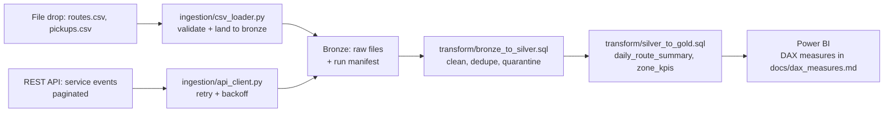

# End-to-End Data Pipeline

**Nightly operations pipeline that turns raw route/pickup CSVs and service-event
API payloads into Power BI-ready gold tables — replacing a manual, spreadsheet-
based reporting process with a tested, idempotent, bronze → silver → gold
pipeline.**

> All data in this repo is **synthetic** (generated by
> `data/generate_synthetic_data.py`). No employer or customer data is included.

## Architecture



## The Why

Operations teams need daily answers to the same questions: how much tonnage did
each route collect, which routes missed pickups, and which zones are falling
below reliability targets. When this data lives in CSV exports and a ticketing
API with no warehouse behind it, reporting is manual, slow, and untrustworthy —
numbers change every time someone re-runs a spreadsheet.

This project builds the system that fixes that: one nightly run that ingests
both source types, validates them against explicit contracts, cleans and
conforms them into a tested warehouse, and publishes two gold tables that BI
connects to directly. Every number in a dashboard traces back to tested SQL.

## Tech decisions & trade-offs

- **Snowflake over Postgres:** Snowflake separates storage and compute, so
  bronze/silver/gold as separate schemas costs nothing extra, and `TRY_TO_DATE`
  / `TRY_TO_NUMBER` let bad rows be quarantined instead of failing the whole
  load. A Postgres build would need more manual orchestration for the same
  staging isolation.
- **Python ingestion instead of Fivetran:** Fivetran can't be demoed publicly,
  and this project's sources are small file drops + one paginated REST API —
  exactly the EL pattern Fivetran would automate. The `api_client.py` implements
  that pattern directly (pagination, exponential backoff on 429/5xx, fail-fast
  on 4xx), and the README documents the mapping so the Fivetran equivalent is
  obvious.
- **Contract-first file drops:** `csv_loader.py` validates required columns,
  duplicate keys, and empty keys *before* anything lands in bronze. Bad files
  fail loud at ingestion time instead of silently poisoning silver.
- **Quarantine, not silent drops:** rows failing quality rules go to
  `silver.<table>_quarantine` with a timestamp. Data quality is a business
  decision (someone owns the fix), not a filter that hides problems.
- **Gold tables are denormalized by design:** BI connects only to gold. One
  wide `daily_route_summary` per route-day means every DAX measure is a simple
  aggregation over a tested model — no spaghetti DAX compensating for a messy
  warehouse.

## Tech stack

| Layer | Tool |
|---|---|
| Ingestion | Python (stdlib `urllib`, `csv`) — zero heavy deps |
| Warehouse | Snowflake (bronze / silver / gold schemas) |
| Transforms | Snowflake SQL |
| BI | Power BI + DAX (measures in `docs/dax_measures.md`) |
| Tests / CI | pytest, GitHub Actions |

## Setup & run

Prerequisites: Python 3.10+.

```bash
make setup   # installs deps, copies .env.example -> .env
make data    # generate the synthetic dataset
make ingest  # validate + load CSVs, ingest API events (offline demo mode)
make test    # run the pytest suite
```

Expected output after `make ingest`: `data/bronze/` contains `routes.csv`,
`pickups.csv`, `service_events.jsonl`, and a `_manifest.json` recording the
run timestamp and row counts per source.

For the warehouse leg, run the SQL in `transform/` against a Snowflake trial
in order: `bronze_to_silver.sql`, then `silver_to_gold.sql`. Set a small
`X-SMALL` warehouse — the sample data is tiny; document your warehouse sizing
choice as you scale.

## Synthetic data strategy

`data/generate_synthetic_data.py` creates the full domain with a fixed seed
(42): 40 routes, 14 days of pickup transactions, and service events that
reference only known routes (enforced by a test). Everything is explicitly
synthetic — there is no path for real customer or employer data to enter this
repo: generators are the only source of `data/samples/`, and bronze outputs
are git-ignored.

## Results

Screenshots/GIFs to capture after a run (add to `docs/`):

1. `data/bronze/_manifest.json` — a successful run's manifest with row counts
2. Snowflake worksheet output of `gold.zone_kpis` (top 10 rows)
3. Power BI model diagram showing `daily_route_summary` relationships
4. One dashboard screenshot per DAX visual, with the "so what" from
   `docs/dax_measures.md`

## Limitations & roadmap

- The API client targets a generic paginated JSON API; auth is bearer-token
  only (OAuth2 refresh flow not implemented).
- Transforms are Snowflake-dialect; a dbt port is covered by the companion
  repo `snowflake-warehouse-dbt-modeling`.
- Orchestration is a Makefile today — the ADF companion repo shows the
  production-scheduled equivalent.
- Roadmap: Great Expectations suite on silver tables, Slack alerting on
  quarantine-row spikes, dbt-ified transforms.

## Tests & CI

`pytest` covers: API pagination + retry behavior (against a local mock HTTP
server), CSV contract validation (missing columns, duplicate keys), and the
same data-quality rules the SQL enforces (no negative tonnage, events reference
known routes). GitHub Actions regenerates the synthetic data, runs the bronze
load in offline mode, and runs the full suite on every push.
